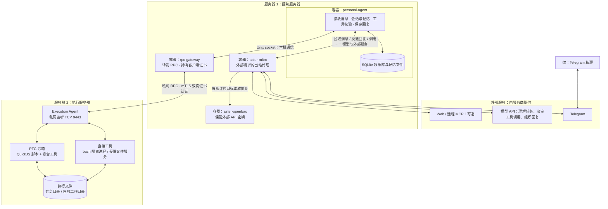
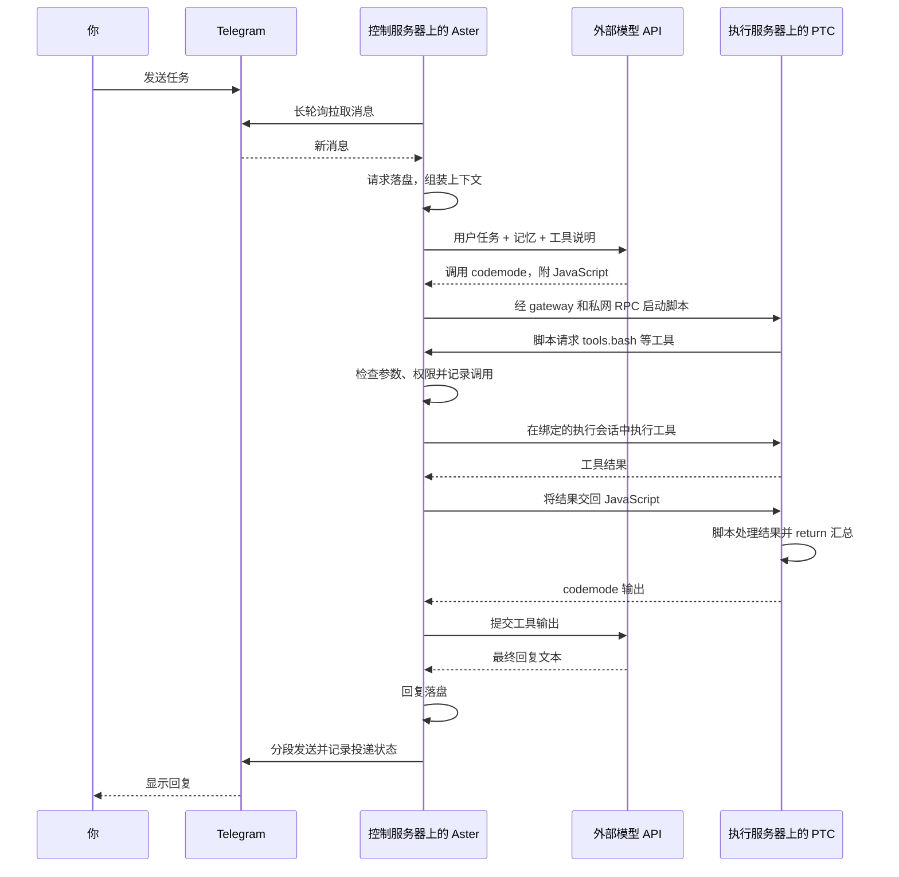

# Aster

[](.node-version) [](package.json) [](https://www.npmjs.com/package/@earendil-works/pi-durable) [](LICENSE)

Aster 是一个通过 Telegram 私聊使用的个人 AI 助手。你发消息，它调用模型理解任务，按需读写文件、执行命令、搜索网页或使用外部工具，再把结果发回 Telegram。它会保存会话、执行进度和记忆，支持进程重启后的恢复。

目前面向**一个所有者、一个会话**，按顺序处理请求。模型通过外部 API 提供，本项目负责把消息、记忆、工具和回复接起来。

**本项目当前完整部署使用两台云服务器：一台负责聊天和保存状态，一台负责执行命令与 PTC 脚本。** 第一次体验也可以只用自己的电脑，不必先购买云服务器。

- [先看懂：需要几台服务器](#需要几台服务器)
- [看架构图：组件分别在哪里](#架构示意图)
- [看流程：一条消息怎样得到回复](#一条消息怎样得到回复)
- [让 agent 带你从零开始](#从零开始让-agent-带你跑起来)
- [部署两台服务器](#部署完整的双服务器版本)
- [数据、排障与验证状态](#数据存在哪里)
- [进一步阅读与开发](#给开发者和维护-agent)

## 需要几台服务器

这里的“服务器”指一台独立的云主机（VPS）。Docker 容器是在服务器上运行的程序环境，一台服务器可以运行多个容器。

| 使用方式 | 需要你准备的机器 | 程序在哪里运行 | 适合什么时候用 |
| --- | --- | --- | --- |
| 本机体验 | 1 台自己的电脑，0 台云服务器 | Aster 和本地工具在电脑上，模型调用外部 API | 第一次启动、理解配置 |
| 单服务器部署 | 1 台云服务器 | 应用和本地工具在同一台服务器；可加同机出站代理与密钥服务 | 熟悉基本部署后使用 |
| 完整 RPC 部署 | **2 台云服务器** | 控制服务器保存状态、连接模型；执行服务器运行远程命令与 PTC | 本项目当前采用的部署形态 |

完整部署的分工如下：

| 位置 | 运行什么 | 用通俗的话说 |
| --- | --- | --- |
| 服务器 1：控制服务器 | `personal-agent`、`rpc-gateway`、`aster-mitm`、`aster-openbao`，共 4 个常驻容器 | 接消息、问模型、检查工具调用、保存记忆、发回复；保管 API 密钥并代理外部请求 |
| 服务器 2：执行服务器 | `aster-rpc-agent` 系统服务，以及按任务启动的隔离进程 | 接受控制服务器的执行请求，运行命令、访问任务文件和执行 PTC 脚本 |
| 外部服务 | Telegram、所选模型 API；按需连接 Web 服务和远程 MCP 服务 | 由对应服务商提供，不需要为它们另买一台 Aster 服务器 |

OpenBao 和出站代理与应用部署在同一台控制服务器上。RPC gateway 也是这台服务器上的容器。PTC 沙箱是执行服务器上的任务进程；这些都已经包含在上面的两台服务器里。

项目的应用部署基线为 4 核 CPU、4 GB 内存；执行服务器的资源还要按命令负载和并发数安排。模型推理由服务商承担，不需要为 Aster 自建 GPU 推理服务器。

## 架构示意图

下图展示完整的双服务器 RPC + 出站代理部署。实线双向箭头表示请求与结果的往返；每个大框都标出了所属位置。



图里有两条主要通道：

- **外部服务通道**：应用 → 出站代理 → Telegram、模型和已配置的外部服务。代理仅对允许的目标，把应用发送的密钥占位符替换成真实 API 密钥；真实密钥保存在 OpenBao。
- **远程执行通道**：应用 → 本机 Unix socket → RPC gateway → 私网 → 执行服务器。这条通道不经过出站代理。mTLS 表示连接双方用证书确认身份；执行 Agent 还会检查客户端证书名称。

应用容器没有到执行服务器的直接网络路由，也不持有执行通道的客户端私钥。工具调用的参数检查、权限判断和执行记录由控制服务器上的应用负责；RPC gateway 只转发字节。

以上服务器数量和部署方式依据 2026-11-03 的 [#59 部署与链路记录](https://github.com/NaoYUN77/Aster/pull/59)及仓库配置。实际运行状态会随运维改变；“部署过、跑通过消息”与“所有验收项通过”各有对应的证据，见[验证状态](#验证状态与当前限制)。

## 一条消息怎样得到回复

以“检查几个任务文件，只告诉我汇总结果”为例。下面是流程说明，不是一段伪造的运行记录。

1. **你在 Telegram 发消息。** 应用主动向 Telegram 拉取新消息，这叫“长轮询”，因此聊天入口不需要暴露一个接收消息的公网端口。应用只接受已配置所有者的私聊。
2. **先保存收到的请求。** 控制服务器把请求写入收件箱，再推进会话。系统提示、记忆和近期对话一起组成给模型的上下文。
3. **模型决定下一步。** 简单问题可以直接回复；需要操作时，模型提出工具调用。如果适合用一段脚本串起多次操作，可以调用 `codemode`。
4. **PTC 执行模型编写的 JavaScript。** 控制服务器通过 RPC 把脚本送到执行服务器。脚本在 QuickJS 中运行，只能通过允许的 `tools.*` 接口请求工具；每次嵌套调用都回到控制服务器，经过校验和授权，再通过 RPC 到执行服务器实际执行。
5. **结果返回脚本，再返回模型。** 脚本可以读取中间结果、筛选和计算，只返回需要的汇总。模型获得 `codemode` 的输出后组织最终回复；有必要时也可以继续调用工具。
6. **先保存回复，再发到 Telegram。** 应用先把回复写入数据库，然后分段投递并记录发送状态。投递失败时重投已保存的回复，不重新执行整项任务。

<details>
<summary>展开查看 PTC 一次调用的往返顺序</summary>



模型和 Telegram 请求经出站代理；图中省略了代理，以便看清业务顺序。执行通道中的脚本工具请求和结果均经 gateway 往返。

</details>

### PTC 是什么，和普通工具调用有什么区别

PTC（Programmatic Tool Calling）就是让模型写代码来调用工具。在本项目里，模型看到的入口工具名是 **`codemode`**。

普通调用时，模型发起一次工具调用、读结果，再决定下一次。PTC 则允许 JavaScript 在一次 `codemode` 调用中串起多次工具操作，并把中间数据留在脚本里处理。它适合批量收集、筛选和汇总，能减少模型往返以及进入对话的中间结果；实际节省取决于任务。

脚本目前只能调用 `read`、`write`、`edit`、`bash` 四项工具，嵌套调用依次执行。MCP、记忆、Web 工具仍由模型直接调用。单次操作可以直接调工具；要让模型逐步判断的任务，也可以分多次调用。

完整 RPC 部署中的执行位置：

| 调用方式 | 实际在哪里执行 | 文件和隔离边界 |
| --- | --- | --- |
| 模型直接调 `bash` | 执行服务器上的隔离进程，经过 bwrap + cgroup | 默认工作目录 `/shared/aster`；进程无外部网络 |
| 模型直接调 `read` / `write` / `edit` | 执行服务器上的受限文件服务 | 只映射允许的共享目录和会话临时目录；不启动 QuickJS 或 bwrap 命令进程 |
| 模型调 `codemode`，脚本再调工具 | 执行服务器上的 PTC 沙箱；QuickJS 与嵌套工具在同一个 PTC 会话中协作 | 私有工作目录 `/workspace`；可用显式挂载的 `/shared` 和私有 `/tmp`；bwrap 隔离进程与网络，cgroup 限制资源 |

`/workspace` 是每项 PTC 任务自己的目录，`/shared/aster` 是直接工具常用的共享任务目录。需要两种方式访问同一批文件时，使用已配置的 `/shared` 路径。控制服务器不会打开执行服务器上的这些文件。

QuickJS 约束 JavaScript 能使用的接口；bwrap 和 cgroup 提供远程进程隔离与资源限制。在本地模式中，工具拥有应用用户或容器的权限，QuickJS 不会额外隔离它调用的本地命令。详细说明见[代码调用工具](docs/codemode.md)。

## 从零开始：让 agent 带你跑起来

这里的“维护 agent”指帮你安装、修改和部署项目的编程助手。它与部署完成后在 Telegram 中回复你的 Aster 是两个角色。下面这段可以直接交给维护 agent：

> 我没有编程或服务器基础，请带我运行这个仓库。先读 README.md、CLAUDE.md、.env.example 和相关部署文档，检查我的操作系统、运行环境，以及 Telegram 和模型 API 的连通性。先在一台电脑或一台服务器上跑通文字聊天，再按需要增加 PTC、Web、MCP 和双服务器 RPC。每一步请说明在哪台机器执行、目的是什么、成功时应该看到什么；缺少信息时向我确认，不要猜配置。请让我在本机配置文件中填写真实凭据，不在聊天或日志中回显。已有部署时先确认 bot、Compose 项目和数据卷，保留数据，避免两个实例同时使用同一个 bot。最后给出实际验证结果和未完成项。

### 1. 准备三样东西

| 要准备的东西 | 怎么得到 | 用在哪里 |
| --- | --- | --- |
| Telegram bot token | 在 Telegram 中通过官方 BotFather 创建 bot | `TELEGRAM_BOT_TOKEN` |
| 自己的 Telegram 数字用户 ID | 请维护 agent 协助确认；不是 `@用户名`、群组 ID 或 bot ID | `TELEGRAM_OWNER_ID`，限定谁能使用助手 |
| 一个模型服务的 API key | 到所选模型服务商的控制台创建；需有可用额度 | 对应的 `*_API_KEY`，按服务商计费 |

模型需要 API 接入。聊天网站的会员订阅与 API key 是不同的接入方式，本项目使用后者。密钥请直接填入本机配置文件，不要提交 Git。

### 2. 首次运行选本机模式

本机源码运行需要 Git 和 **Node.js 24.19.0（24.x，低于 25）**；这与仓库的 [.node-version](.node-version) 和 [package.json](package.json) 一致。电脑还需要能访问 Telegram 和所选模型服务。先让维护 agent 检查这些条件，再执行：

```sh
git clone https://github.com/NaoYUN77/Aster.git
cd Aster
npm ci
cp .env.example .env
```

上述复制命令适用于 Linux、macOS 和 Git Bash；Windows PowerShell 使用 `Copy-Item .env.example .env`。已有 `.env` 时保留并核对，不要覆盖。

打开 `.env`，下面是使用 DeepSeek 的本机配置示例；把尖括号里的说明替换成自己的值：

```dotenv
TELEGRAM_BOT_TOKEN=<BotFather 给你的真实 token>
TELEGRAM_OWNER_ID=<你自己的 Telegram 数字用户 ID>
MODEL_PROVIDER=deepseek
MODEL_ID=deepseek-flash
DEEPSEEK_API_KEY=<你的真实模型 API key>
DATA_DIR=./data
```

**`.env.example` 中的 `__vault_...__` 是代理模式使用的占位符。** 本机直连运行时，要把 bot token 和当前模型 key 的占位符改成真实值；只有部署好 OpenBao + 出站代理后才使用占位符。`MODEL_ID` 必须是当前依赖支持的精确名称，不能填写模型网站上的任意展示名。

然后执行：

```sh
npm run check
npm test
npm run build
node --env-file=.env dist/src/check-config.js
npm start
```

配置检查应输出 `Configuration OK: ...`；启动应出现 `Personal agent starting; single-owner private Telegram messages enabled.`。在 Telegram 中用所有者账号私聊 bot，发送“现在几点？”，确认收到回复。终端里的进程要保持运行；长期部署使用下一节的 Docker 方式。

这里的测试是离线测试，不调用收费模型或 Telegram。**真正私聊 bot 会调用已配置的模型 API。** Windows 上部分 Linux 专用测试会跳过，跳过不代表已验证。若 bot 已使用 webhook，应用会拒绝启动；先核对旧部署并停用 webhook，避免抢占同一个 bot。

<details>
<summary>换用其他模型服务时，应该填哪个 key 变量？</summary>

| `MODEL_PROVIDER` | API key 变量 |
| --- | --- |
| `anthropic` | `ANTHROPIC_API_KEY` |
| `openai` | `OPENAI_API_KEY` |
| `deepseek` | `DEEPSEEK_API_KEY` |
| `google` | `GEMINI_API_KEY` |
| `xai` | `XAI_API_KEY` |
| `mistral` | `MISTRAL_API_KEY` |
| `groq` | `GROQ_API_KEY` |
| `moonshotai`、`moonshotai-cn` | `MOONSHOT_API_KEY` |
| `minimax` | `MINIMAX_API_KEY` |
| `zai` | `ZAI_API_KEY` |
| `openrouter` | `OPENROUTER_API_KEY` |

只填当前服务商需要的 key。支持范围以 [src/providers.ts](src/providers.ts) 为准；模型 ID 来自已安装 pi-ai 的模型目录，填错时离线配置检查会提示候选。本项目不接受自定义模型 base URL 或云厂商环境凭据。

</details>

### 3. 按需开启能力

先跑通聊天，再让维护 agent 帮你开启需要的功能。修改配置后需重启。

| 能力 | 怎么开启 | 注意什么 |
| --- | --- | --- |
| 记忆 | 默认开启；`MEMORY_ENABLED=0` 可关闭 | 明确要求记住、纠正或忘记时使用记忆工具；不自动建立偏好画像，不保存凭据 |
| PTC / codemode | 本机设置 `CODEMODE_ENABLED=1`；RPC Compose 默认启用 | 本机 PTC 仍使用本机工具；启用此项本身不会部署第二台服务器 |
| 网页搜索和抓取 | 配置独立的 `DEEPSEEK_WEB_API_KEY` | 注册 `web_search`、`web_fetch`；与模型 key 分开，远端调用可能计费 |
| Notion 等 MCP 工具 | 按 [MCP 文档](docs/mcp.md) 配置 `DATA_DIR/mcp.json`，完成相应授权 | MCP 是让助手接入外部工具的协议；默认不连接，工具通过 `tool_search` 按需加载 |
| GitHub 只读工具 | 按 [GitHub 接入文档](docs/github-access.md) 配置凭据、代理与独立审批基线 | 默认关闭；12 项只读工具，缺少审批或工具声明变化时停用 |

## 部署完整的双服务器版本

Docker 用来把应用及依赖打包成镜像；Docker Compose 文件说明要运行哪些容器、如何连接，以及数据放在哪里。`docker compose up` 启动容器，持久化数据保存在单独的数据卷中。

单服务器长期运行可以先按[Docker 部署指南](docs/deployment-test-guide.md)部署一个 `personal-agent` 服务。下面是升级到图中双服务器拓扑的顺序，适合让维护 agent 按对应手册逐项执行。

| 顺序 | 在哪里做 | 做什么、完成后检查什么 | 操作手册 |
| --- | --- | --- | --- |
| 1 | 两台服务器 | 确认 Linux 环境、私网可达、证书名称和数据目录；执行面具备 bwrap、cgroup v2 等隔离条件 | [RPC Runbook](docs/runbook-remote-ptc-phase1-2.md) |
| 2 | 执行服务器 | 部署 `aster-rpc-agent` 系统服务；只绑定私网，强制 mTLS、检查客户端 CN；先做预检与隔离检查 | 同上 |
| 3 | 控制服务器 | 部署 OpenBao 与 MITM 出站代理，配置密钥、允许的目标和应用使用的占位符 | [OpenBao + MITM](deploy/openbao-mitm/README.md) |
| 4 | 控制服务器 | 准备应用镜像、环境文件、持久化卷、gateway 证书和 Unix socket 目录 | [Docker 部署指南](docs/deployment-test-guide.md)、[Runbook §5.4](docs/runbook-remote-ptc-phase1-2.md#54-全线-rpcapp-容器--宿主-gateway) |
| 5 | 控制服务器发起，执行服务器配合 | 验证 Telegram 往返、直接 bash 与文件工具、codemode、大输出、取消与恢复；分别记录结果 | [Runbook](docs/runbook-remote-ptc-phase1-2.md)、[验收记录](docs/acceptance/20261103-remote-ptc-phase2.md) |

第 4 步应用侧使用的文件组合是：

```text
docker-compose.yml          基础应用和持久化数据卷
+ docker-compose.mitm.yml    应用通过出站代理连接外部服务
+ docker-compose.rpc.yml     应用通过 gateway 连接远程执行服务器
```

OpenBao 与 MITM 自身由 `deploy/openbao-mitm/compose.yml` 管理。三个应用侧 Compose 文件叠加，并不会自动部署第二台服务器或创建证书；必须先完成表中的准备步骤。`aster:local` 是本地镜像标签，项目目前没有可直接拉取的公共生产镜像，需按部署指南构建或分发。

RPC 方案统一承载直接工具与远程 PTC。仓库还保留 `docker-compose.execution.yml` 的 SSH broker 兼容路径：直接工具只支持 `bash`，直接文件工具返回 `not_supported`。完整 RPC 部署使用 `docker-compose.rpc.yml`，不同时叠加 SSH execution 文件。切换执行方式前先让未完成任务收敛；远程不可用时会明确失败，不自动回退到控制服务器执行。

## 数据存在哪里

**控制服务器保存会话和投递状态；执行服务器保存实际任务文件。** 两边都要纳入备份计划。

| 位置 | 内容 | 为什么要保留 |
| --- | --- | --- |
| 控制面 `agent.sqlite` 及 SQLite 相关文件 | 会话、执行恢复记录、工作记忆与上下文快照 | 重启后继续会话、核对工具执行状态 |
| 控制面 `inbox.sqlite` 及 SQLite 相关文件 | 收件记录、bot / owner 绑定、回复与分段投递状态 | 判断消息收到没有、回复发送到哪一段 |
| 控制面 `memory/daily/` | 从已确认会话中归档的每日事件记忆 | 检索过去的事实 |
| 控制面 `mcp.json`、`mcp-oauth/`（可选） | 外部工具配置及授权状态 | 连接已授权的服务 |
| 执行面共享目录和 job 工作目录 | `/shared`、PTC `/workspace` 对应的宿主目录，以及大输出文件 | 保留工具产生的实际内容；控制面数据库只保存有界结果和引用 |
| 本地模式 `DATA_DIR/workspace/` | 本机工具的任务文件 | 本地运行时文件保存在应用数据目录 |

源码运行的 `DATA_DIR` 默认是 `./data`。Docker 中应用数据目录固定为 `/data`，基础卷名为 `personal-agent-data`。同一数据目录只允许一个应用进程使用，并绑定 bot 与 owner；不能随意换一个 bot 接着使用原卷，也不要让两个实例争用同一 bot。

按[部署指南的整卷备份步骤](docs/deployment-test-guide.md#6-备份与还原整个卷)操作，先停止应用再备份。普通更新保留数据卷；`docker compose down -v` 会删除卷，不能拿它代替普通重启。只备份控制面卷不会备份执行服务器上的任务文件，也不会备份独立部署的 OpenBao 密钥服务。

记忆通过 `working_read` / `working_update` 管理当前状态，通过 `memory_search` / `memory_read` 检索过去事件。对话很长时，系统把稳定规则、周期摘要和近期原文分开组织；“记得过去的事实”和“恢复未完成工具调用”是不同机制。细节见[记忆与上下文设计](docs/memory-and-context-design.md)。

## 遇到问题先看什么

| 现象 | 先让维护 agent 检查 |
| --- | --- |
| 启动提示缺配置或模型不存在 | `.env` 的必填项、提供商 key 变量名、精确 `MODEL_ID`；先跑离线配置检查 |
| 程序启动了，但 Telegram 不回复 | 是否用所有者账号私聊、数字 ID 是否正确、有没有旧实例或 webhook，以及 Telegram / 模型连通性 |
| 把 `.env.example` 原样复制后认证失败 | 当前是否使用代理；本机直连时不能用 `__vault_...__` 代替真实凭据 |
| 找不到 `codemode` | `CODEMODE_ENABLED` 和实际启动的 Compose 文件；改配置后是否重启 |
| SSH 模式下文件工具返回 `not_supported` | 直接文件工具需要统一 RPC；按 Runbook 完成切换 |
| 远程工具启动或执行失败 | Unix socket、gateway、执行 Agent、私网证书，以及隔离预检；保留真实错误，不改成本地执行 |
| 控制面文件工具找不到 PTC 任务文件 | 分清本机数据目录、执行面共享目录和每个 job 的 `/workspace`；使用远程工具和正确路径 |
| 命令可能执行了，但没收到回复 | 先核对执行记录和投递状态；按[投递核查与补发](docs/deliveries.md)处理，避免直接重跑有副作用的任务 |

## 验证状态与当前限制

仓库里的自动化测试、真实聊天和完整双服务器验收分别说明不同范围的结果：

- **自动化基线**：2026-11-03，`main` 提交 `0ea4da5` 的 [CI 41654885450](https://github.com/NaoYUN77/Aster/actions/runs/41654885450) 成功。Node job 共 382 项，374 通过、0 失败、8 跳过；镜像 job 还覆盖卷预检、只读 WAL 和 Compose 拓扑。此记录对应该提交，不代表之后的所有版本。
- **部署与消息链路记录**：2026-11-03 的 [#59 部署记录](https://github.com/NaoYUN77/Aster/pull/59)包含双服务器全线 RPC、gateway 健康检查、应用直连隔离，以及模拟消息经过模型、远程 PTC 和 Telegram 投递的证据。本 README 更新没有再次执行生产环境检查，也未新增完整验收报告。
- **完整 Phase 1／2 验收仍需核对**：[仓库验收记录](docs/acceptance/20261103-remote-ptc-phase2.md)保留了两轮实机失败及修复后的待复验项，不能据聊天跑通或 CI 成功把它们改成全部通过。隔离、强杀清理、取消、恢复和未知结果等项目仍按 Runbook 留证。
- **模型质量与发布范围**：[记忆系统验收](docs/memory-verification.md)包含一次 DeepSeek 真实模型补测；其他提供商的记忆提取质量需单独验证。CI 未覆盖真实 Telegram 到模型再投递的业务链，镜像发布与生产更新也需操作者执行。

当前单会话、串行处理，单次请求等待上限 5 分钟。重启后系统依据保存的状态恢复；对中断时结果未知的命令，不会把它当作“没执行过”并随意重跑。Telegram 发送与外部写操作不保证恰好一次，可能需要人工核对。另有[已知轮数计数边界 #26](https://github.com/NaoYUN77/Aster/issues/26)：回复已保存但收尾前崩溃时，压缩评估计数可能滞后一轮。

## 给开发者和维护 agent

应用基于 pi-durable 1.3.0，复用其模型循环、工具执行和持久化机制。Node.js、TypeScript 及直接依赖版本由版本文件和 lockfile 固定。首次修改前阅读 [CLAUDE.md](CLAUDE.md)。

| 想看哪部分 | 从哪里开始 |
| --- | --- |
| 程序入口和配置 | [src/main.ts](src/main.ts)、[src/config.ts](src/config.ts) |
| 消息接收、落盘和投递 | [src/telegram.ts](src/telegram.ts)、[src/inbox.ts](src/inbox.ts) |
| 会话、上下文与记忆 | [src/agent.ts](src/agent.ts)、[src/memory/](src/memory/) |
| 工具注册、MCP 和模型提供商 | [src/tools.ts](src/tools.ts)、[src/mcp.ts](src/mcp.ts)、[src/providers.ts](src/providers.ts) |
| PTC 与远程执行 | [src/codemode.ts](src/codemode.ts)、[src/ptc-gateway.ts](src/ptc-gateway.ts)、[src/execution/](src/execution/) |

```sh
npm run check   # 类型检查
npm run build   # 编译
npm test        # 离线测试；Linux 专用行为需在 Linux 验证
```

按问题查文档：

| 需要做什么 | 文档 |
| --- | --- |
| 部署应用、升级、备份与还原 | [Docker 部署指南](docs/deployment-test-guide.md)、[部署环境](docs/deployment-environments.md) |
| 部署密钥服务与出站代理 | [OpenBao + MITM](deploy/openbao-mitm/README.md) |
| 部署双服务器 RPC、验收与回滚 | [远程 PTC Runbook](docs/runbook-remote-ptc-phase1-2.md)、[验收记录](docs/acceptance/20261103-remote-ptc-phase2.md) |
| 理解 SSH 兼容路径或 Phase 0 | [远程工具执行](docs/execution-remote.md)、[Phase 0 Runbook](docs/runbook-execution-rpc-phase0.md) |
| 配置外部工具、PTC 或 GitHub | [MCP](docs/mcp.md)、[codemode](docs/codemode.md)、[GitHub 只读接入](docs/github-access.md) |
| 理解记忆与模型上下文 | [设计](docs/memory-and-context-design.md)、[验收](docs/memory-verification.md) |
| 处理投递、恢复和工具错误 | [投递核查与补发](docs/deliveries.md)、[契约与生命周期](docs/contracts-and-lifecycle.md) |
| 查 CI 与运维边界 | [CI 入口](docs/ci-entrypoint.md)、[主机备份](docs/host-backup.md) |
| 查架构取舍与文档约定 | [ADR 索引](docs/adr/)、[文档索引与临时 spec 约定](docs/README.md) |
