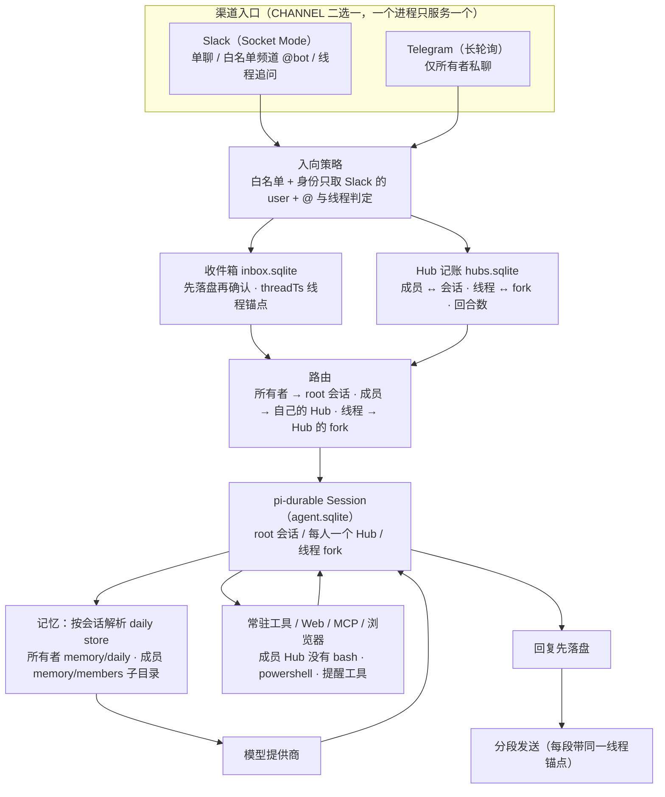

# Aster

[](https://www.typescriptlang.org/) [](https://nodejs.org/) [](https://grammy.dev/)  [](https://nodejs.org/api/sqlite.html) [](https://docs.docker.com/)  [](https://www.npmjs.com/package/@earendil-works/pi-durable) [](LICENSE)

个人 AI agent：所有者通过私聊使用；Slack 下还可以在**白名单频道**里当团队助手——@ 它提问、在它的回复下追问，每位成员一个独立会话（Hub）。消息在可恢复的 durable 执行环境里运行 agent 与工具，再把回复分段送回。渠道二选一：Telegram 长轮询或 Slack Socket Mode。它有长期记忆、能接入 MCP 工具，面向一台小规格云服务器长期运行。

下面描述当前可用能力。

基于 `@earendil-works/pi-durable`（1.5.0）构建。现已部署在腾讯云服务器上并持续运行：真实服务器上的 Telegram 往返、记忆落盘和容器重启恢复都在这次运行里。日期、镜像 digest 等脱敏细节还没写进仓库，可以补在 [部署与运维手册](scripts/deploy/README.md) 的上线判定一节。

## 架构

一条消息的路径：渠道收件（Telegram 长轮询或 Slack Socket Mode）→ 入向策略（白名单、身份只取传输层参数、@/线程判定）→ 收件箱落盘（含线程锚点）→ 路由到一个会话（所有者的 root 会话、成员自己的 Hub、或线程的 fork）→ 记忆层组装上下文 → 模型层调用提供商 → 工具层执行 → 回复落盘后带线程锚点分段发送。



观测是旁路：每个请求一条 Langfuse trace（`agent.request` → `llm.generation` / `tool.execution` / `registry.decision` / `loop_guard.*`），只记标识、长度、耗时与结果码，不记正文与凭据。

| 层 | 职责 | 主要文件 |
| --- | --- | --- |
| 入口与部署 | 组合接线、部署渲染、环境预检、发布清单 | `src/main.ts`、`src/deployment-*.ts`、`src/release-*.ts` |
| 渠道 | 二选一的消息通道：Telegram 长轮询或 Slack Socket Mode；单聊只服务所有者，Slack 还接白名单频道里的 @ 与会话线程；持久化收件箱（offset 检查点、线程锚点、分段投递与对账）与共享的投递/失败分类（`src/channel.ts`） | `src/telegram.ts`、`src/slack.ts`、`src/channel.ts`、`src/inbox.ts` |
| 团队 Hub | 成员 ↔ 会话映射、线程 ↔ fork 记账与回合上限；一人一个 Hub 的隔离边界 | `src/hubs.ts` |
| 运行时 | 基于 pi-durable 的 Session：durable 执行、checkpoint、replay 恢复；按请求选择会话（root / Hub / fork） | `src/agent.ts` |
| 记忆 | 归档、工作状态、压缩、上下文规划与快照、生命周期接入与记忆工具；store 按会话解析，因此每人一份 | `src/memory/` |
| 工具 | 工具注册表（常驻 + deferred）、MCP 接入与 OAuth 凭据保管 | `src/tools.ts`、`src/mcp*.ts` |
| 模型 | 提供商注册表、声明文件解析、模型目录拉取与解析、启动前目录校验 | `src/providers.ts`、`src/provider-config.ts`、`src/provider-catalog.ts` |
| 配置 | `.env` 解析与严格校验（缺项/错项启动前失败），含频道白名单 | `src/config.ts` |
| 存储 | 会话/checkpoint/记忆与投递状态，位于数据目录 | `agent.sqlite`、`inbox.sqlite`、`hubs.sqlite` |

数据目录：

| 路径 | 内容 |
| --- | --- |
| `agent.sqlite`（及 WAL） | 底座会话与执行恢复状态；记忆系统的 working 状态、周期快照投影、归档进度与轮数计数 |
| `inbox.sqlite`（及 WAL） | 请求消费位置、身份绑定与投递状态 |
| `workspace/` | agent 的任务文件 |
| `memory/daily/YYYY-MM-DD.md` | 每日事件记忆：归档任务从已确认的会话范围增量提取 |
| `mcp.json`（可选） | MCP server 配置 |
| `mcp-oauth/<server>.json`（可选） | 远程 MCP server 的 OAuth token，仅属主可读 |
| `providers.json`（可选） | 自定义模型提供商声明（地址与凭据变量名）；随数据目录一起备份 |

约束：同一数据目录只允许一个应用进程（镜像入口以 `flock` 互斥）。数据目录绑定 bot 与 owner，不能换身份续用。同一个数据目录下可以有多个会话（所有者的 root 会话、每位成员一个 Hub、每条线程一个 fork），但请求仍串行、工具顺序执行，单个请求等待上限 5 分钟，超时向底座请求取消（外部副作用不保证可撤销）。接入每次最多取 10 条 update，处理完本地待办再轮询。

## 已验证与尚未验证

生产状态以所有者确认为准。下面的测试和 CI 数字以仓库里的记录为准。

**已有记录**

- 类型检查、离线测试和构建。2026-10-29 的 main 运行 [40826470475](https://github.com/NaoYUN77/Aster/actions/runs/40826470475)（提交 `07876f8`）中，Node job 为 235 项、227 过、0 失败、8 跳过。这 8 项是卷预检里需要 root 或单独 Docker 开关的用例；同一运行的镜像 job 另跑了对应检查（8 过 1 跳过，以及只读 WAL 1/1）。
- 最终镜像与单服务拓扑 6 项：Compose 边界、缺 provider key 时不回显凭据、同卷 `flock`、离线卷预检与整卷备份还原、容器日志不含合成凭据。脚本写明不覆盖真实 Telegram／模型链路，见 [CI 门禁](scripts/ci/README.md)。
- 记忆机制的离线验收，以及一次 DeepSeek 真实模型补测（28 次调用里 27 次前缀缓存命中，约 87%）。腾讯云 4 核、7680 MB 的机器在同一份记录里跑过验收测试和资源测量（峰值 RSS 约 136 MiB）。那是测试补测，不是部署验收。
- 启动配置在联网前拒绝未知提供商和未知模型 id；进程日志只打印本应用的配置／状态错误或错误码（`src/config.ts`、`src/main.ts`）。这是代码和测试里的行为，不是一份生产日志审计。
- 生产环境已部署在腾讯云服务器上并持续运行，包括真实服务器上的 Telegram 往返、记忆落盘和容器重启恢复。仓库里还没有日期或镜像 digest。

**仓库记录尚未覆盖**

- CI 里的 Telegram → 模型 → 投递业务链。当前拓扑日志写的是 NOT COVERED。
- 镜像发布、签名和手动生产更新。没有 `release.yml` / `deploy.yml`；离线发布预检成功时仍标注 `productionAdmission: "not-evaluated"`。
- DeepSeek 以外的提供商的真实摘要与归档质量。

**已知限制**

- 回复已持久化但请求收尾未执行时进程被杀，该轮的轮数计数会永久滞后一轮（回复与状态一致，压缩评估点后移）。见 issue #26。
- 请求串行：一个进程一次只跑一条请求，Hub 之间也不并行。长期繁忙时消息留在渠道侧。
- `bash` 等工具不是沙箱。

## 对话示例

> **TODO（维护者填写）**
>
> 放一段脱敏后的真实 Telegram 往返。不要编造对话。建议包含一条普通请求、一次工具调用、一次「记住这件事」，以及进程重启后的追问。删掉 token、用户 ID、文件路径和任何密钥。
>
> 在补上之前，本节不是能力证据。

## 快速开始

需要 Node.js 24.19.0+，以及可访问 Telegram 与所选模型服务的网络。

```sh
npm ci
cp .env.example .env
# 填写 .env（见下）
npm run check
npm test
npm run build
npm start
```

开发运行用 `npm run dev`。测试全部离线（faux 模型 + 本地 SQLite），不调用收费模型、Telegram 或 Slack。

`.env` 必填项：

- `CHANNEL`（可选，默认 `telegram`）：当前生效的渠道，`telegram` 或 `slack`。只要求所选渠道自己的变量，另一个渠道的变量会被忽略。
- `TELEGRAM_BOT_TOKEN` / `TELEGRAM_OWNER_ID`：`CHANNEL=telegram` 时必填，BotFather 创建的 bot token 与允许使用 bot 的个人数字用户 ID。
- `SLACK_BOT_TOKEN` / `SLACK_APP_TOKEN` / `SLACK_OWNER_ID`：`CHANNEL=slack` 时必填。
- `SLACK_ALLOWED_USERS` / `SLACK_ALLOWED_CHANNELS`（可选）：允许在频道里驱动 bot 的成员与允许回话的频道；空着就是只服务所有者单聊。
- `MODEL_PROVIDER` / `MODEL_ID`：内置注册表内的提供商 id，或 `DATA_DIR/providers.json` 里声明的自定义 provider id，以及该提供商目录中的模型 id。写错时启动前报错并列出示例，不自动替换。
- 所选提供商对应的 API key（见下表；只要求当前所选的那个，其余留空不算缺项）。

| `MODEL_PROVIDER` | API key 变量 |
| --- | --- |
| `anthropic` | `ANTHROPIC_API_KEY` |
| `openai` | `OPENAI_API_KEY` |
| `deepseek` | `DEEPSEEK_API_KEY` |
| `google` | `GEMINI_API_KEY` |
| `xai` | `XAI_API_KEY` |
| `mistral` | `MISTRAL_API_KEY` |
| `groq` | `GROQ_API_KEY` |
| `moonshotai`、`moonshotai-cn` | `MOONSHOT_API_KEY` |
| `minimax` | `MINIMAX_API_KEY` |
| `zai` | `ZAI_API_KEY` |
| `openrouter` | `OPENROUTER_API_KEY` |

注册表定义在 `src/providers.ts`。本应用只支持显式 API key 的提供商：不含 OAuth／订阅登录、云厂商环境凭据（Bedrock、Vertex）。自建的 OpenAI 兼容网关（包括按模型选择 `openai-completions`／`openai-responses`／`anthropic-messages`／`google-generative-ai` 四种协议）用 `DATA_DIR/providers.json` 声明，不需要改代码：`PROVIDERS_CONFIG` 可换路径，`MODEL_ID` 从声明或该网关的 `/models` 目录解析，凭据变量名由声明里的 `apiKeyEnv` 给出并与其他提供商走同一套必填与占位符校验。声明 provider 的启动预检会真的请求它的目录端点，因此该路径不再离线。

常用可选项（均有默认值，注释里的数字与 `src/memory/contracts.ts`、`src/config.ts` 一致，完整清单见 `.env.example`）：

- `DATA_DIR`：持久化数据目录，默认 `./data`（Docker 部署固定为 `/data`）。
- `TELEGRAM_API_ROOT`：Telegram Bot API 的根地址覆盖。服务器无法直连 `api.telegram.org` 时，可指向自建 https 反向代理。仓库没有记录这项是否在某台机器上使用。
- Slack 没有对应的地址覆盖项：`slack.com` 与 Socket Mode 的 `wss-primary.slack.com` 在部署过的机器上都能直连，出站仍可按需走 MITM 代理。
- `MEMORY_ENABLED`：记忆系统总开关，默认开；设 `0` 整体关闭。其余 `MEMORY_*` 为预算、时区与归档超时。
- `MCP_CONFIG`：MCP 配置文件路径，默认 `DATA_DIR/mcp.json`。
- `PROVIDERS_CONFIG`：自定义提供商声明文件路径，默认 `DATA_DIR/providers.json`；默认文件缺失表示没有自定义提供商。
- `DEEPSEEK_WEB_API_KEY`：可选；设置后启用内置 `web_search` 与 `web_fetch`，与模型 key 分开配置。
- `EXA_API_KEY`：可选；设置后启用内置 `exa_search`（Exa Search API），与模型 key 和其他 Web 凭据分开配置。免费账户每月 $10 credits，另有一次 $10 开户奖励；具体单价与边界见下方「内置 Web 工具」。
- `LANGFUSE_PUBLIC_KEY` / `LANGFUSE_SECRET_KEY`：可选；两个都设置时启用 Langfuse Cloud Trace，可用 `LANGFUSE_TRACING_ENABLED=0` 临时关闭。默认只上报 id、长度、计数、工具名和错误码，不上传消息、脚本、参数或文件内容。MITM 模式下 secret key 使用 `__vault_LANGFUSE_SECRET_KEY__`。

私聊 bot 后直接发送文字即可（Slack 下是与 bot 的单聊）。Telegram 若已配置 webhook，应用会拒绝启动，需先在原部署中停用 webhook。

## 记忆系统

每次请求的上下文分三区：A 区为稳定规则（系统提示与工具声明，保持不变以利用提供商前缀缓存）；B 区为周期快照（连续性摘要与 working 基线，只在压缩或重置正式生效时切换）；C 区为实时尾巴（近期原文、工具结果与本轮检索结果）。

| 工具 | 用途 |
| --- | --- |
| `working_read` / `working_update` | 读取 / 按预期版本更新当前任务状态 |
| `memory_search` | 按关键词与日期范围检索每日事件记忆 |
| `memory_read` | 按日期 + 段落 id 精确读取一条每日事件 |

已确认的会话范围由后台归档任务增量提取为 `memory/daily/*.md`。归档失败只记录状态，不影响聊天。检索超限返回明确错误，不静默截断。早期的 `workspace/MEMORY.md` 已退役。

## 工具

常驻工具包括底座的 `bash`、`read`、`write`、`edit`，以及 `current_time`、上表中的记忆工具和配置对应 Web 凭据后启用的 `web_search`、`web_fetch` 与 `exa_search`。内置工具使用底座 `defineTool` 注册；名称冲突在注册时直接拒绝。工具不是文件系统沙箱，生产环境应使用独立低权限用户运行。

## 常驻任务

常驻任务（standing task）是宿主按计划发起的一次 agent 运行，不需要你先说话。用聊天创建即可："以后每天 8 点帮我做早报" → `routine_create`。两种模式：

| 模式 | 行为 | 成本 |
| --- | --- | --- |
| `agent` | 在任务自己的会话里跑一次完整 agent，把结果发给你 | 每次一次模型调用 |
| `notify` | 直接发送模板文本，支持 `{{date}}`、`{{time}}`、`{{title}}` | 零模型调用 |

调度支持 `daily`（`at`）、`weekly`（`days` + `at`）、`every`（`every_minutes`，可带 `from`/`to` 窗口），时间按任务时区（默认 `Asia/Shanghai`）的墙上时间解释。日程在领取时先推进再执行，同一时间槽只会运行一次；停机错过超过 6 小时的槽位记为 `skipped` 而不是补跑。失败只对超时、未作答、截断和空回复重试一次，间隔 120 秒；进程中断的运行标记为失败，不会自动重放。

每个任务有独立会话、独立工作目录和独立长期记忆（`memory/routines/<id>`），不会污染主人的上下文。`delivery=report` 时，模型回复 `NO_REPORT` 表示无事可报，宿主动不发消息。

管理工具：`routine_list`、`routine_pause`（`all=true` 即聊天里的总开关）、`routine_resume`、`routine_delete`、`routine_run_now`。环境层还有一个急停：`ROUTINES_PAUSED=1`，调度器不领取任何任务。每日 21:00（`ROUTINES_SUMMARY_TIME`）发一条用量摘要，agent 运行数超过近 7 天日均 3 倍且不少于 5 次时额外告警；`ROUTINES_MAX_RUNS_PER_DAY` 默认 0（不设硬上限），设为正数才启用硬停止。

事件触发（GitHub、RSS → 任务）属于第二批，本批只交付定时类。

## 部署与运维

生产形态是单个 Docker 服务。镜像构建、Compose、卷备份与还原、维护命令、上线判定见 [部署与运维手册](scripts/deploy/README.md)。结果未知的 Telegram 发送如何核查和补发见该手册。

凭据只经部署环境提供。应用只做存在性与形状校验，不把秘密写入工具参数或 durable 状态。

可选的 MITM 占位符模式（密钥留在 OpenBao，应用只见 `__vault_<NAME>__`）见 [OpenBao + MITM 部署](deploy/openbao-mitm/README.md)，应用侧 overlay 为 `docker-compose.mitm.yml`。代理只在客户端显式发送占位符、且目标 Host 精确命中 [`allowlist.json`](deploy/openbao-mitm/addon/allowlist.json) 时才填充；不按目标自动补 `Authorization`，不替换请求体，无映射返回 `403`。

### 内置 Web 工具

`web_search`、`web_fetch` 与 `exa_search` 直接通过 Aster 的工具注册表执行，不需要 `mcp.json` 或额外进程。设置独立的 `DEEPSEEK_WEB_API_KEY` 并重启后 `web_search` 与 `web_fetch` 同时注册；设置 `EXA_API_KEY` 后注册 `exa_search`。两组凭据互不影响，未配置的那一组工具不向模型声明。Search 返回来源与摘要，Fetch 返回规范化标题和 Markdown 正文，`exa_search` 返回来源、snippet、发布时间，以及供应商关于结果如何生成的 notice。

三项工具按只读权限治理，但远端调用可能计费，因此不可自动重放。它们共享最多 2 个正在执行的请求，单次等待上限 20 秒；两个 Search 的上游响应限 256 KiB、Fetch 限 512 KiB，模型可见结果限 24 KiB；搜索最多 10 条结果。Exa 免费账户每月 $10 credits、另有一次 $10 开户奖励（不绑卡），`exa_search` 固定 `type:"auto"` 且结果上限 10 条，以匹配其基础价。Fetch 会拒绝凭据 URL、IP literal、localhost／常见内部域名和自定义端口；这些本地检查不构成对供应商远端 DNS、重定向或 SSRF 行为的保证。供应商契约、价格与详细边界以本节为准；三项工具的真实 key 端到端验证尚未完成。

## 开发

```sh
npm run check   # 类型检查
npm run build   # 构建
npm test        # 全量离线测试
```

## 文档

- [部署与运维手册](scripts/deploy/README.md)：镜像交付、Compose、卷备份与还原、维护命令、上线判定
- [CI 门禁](scripts/ci/README.md)
- [技术栈与版本基线](CLAUDE.md)
