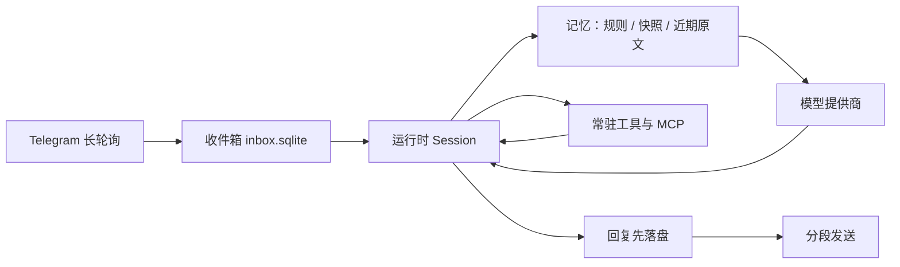

# Aster

[](https://www.typescriptlang.org/) [](https://nodejs.org/) [](https://grammy.dev/) [](https://nodejs.org/api/sqlite.html) [](https://docs.docker.com/) [](docs/mcp.md) [](https://www.npmjs.com/package/@earendil-works/pi-durable) [](LICENSE)

单 owner 的个人 AI agent：从 Telegram 私聊接收消息，在可恢复的 durable 执行环境里运行 agent 与工具，再把回复分段送回。它有长期记忆、能接入 MCP 工具，面向一台小规格云服务器长期运行。

基于 `@earendil-works/pi-durable`（1.3.0）构建。现已部署在腾讯云服务器上并持续运行：真实服务器上的 Telegram 往返、记忆落盘和容器重启恢复都在这次运行里。日期、镜像 digest 等脱敏细节还没写进仓库，可以补在 [部署指南](docs/deployment-test-guide.md#9-上线判定与验证边界)。

## 架构

一条消息的路径：Telegram 长轮询 → 渠道层收件箱落盘 → 运行时恢复或推进会话 → 记忆层组装上下文 → 模型层调用提供商 → 工具层执行 → 回复落盘后分段发送。



| 层 | 职责 | 主要文件 |
| --- | --- | --- |
| 入口与部署 | 组合接线、部署渲染、环境预检、发布清单 | `src/main.ts`、`src/deployment-*.ts`、`src/release-*.ts` |
| 渠道 | Telegram 长轮询与所有者过滤；持久化收件箱（offset 检查点、分段投递与对账） | `src/telegram.ts`、`src/inbox.ts` |
| 运行时 | 基于 pi-durable 的 Session：durable 执行、checkpoint、replay 恢复 | `src/agent.ts` |
| 记忆 | 归档、工作状态、压缩、上下文规划与快照、生命周期接入与记忆工具 | `src/memory/` |
| 工具 | 工具注册表（常驻 + deferred）、MCP 接入与 OAuth 凭据保管 | `src/tools.ts`、`src/mcp*.ts` |
| 模型 | 提供商注册表与模型解析、启动前目录校验 | `src/providers.ts` |
| 配置 | `.env` 解析与严格校验（缺项/错项启动前失败） | `src/config.ts` |
| 存储 | 会话/checkpoint/记忆与投递状态，位于数据目录 | `agent.sqlite`、`inbox.sqlite` |

数据目录：

| 路径 | 内容 |
| --- | --- |
| `agent.sqlite`（及 WAL） | 底座会话与执行恢复状态；记忆系统的 working 状态、周期快照投影、归档进度与轮数计数 |
| `inbox.sqlite`（及 WAL） | 请求消费位置、身份绑定与投递状态 |
| `workspace/` | agent 的任务文件 |
| `memory/daily/YYYY-MM-DD.md` | 每日事件记忆：归档任务从已确认的会话范围增量提取 |
| `mcp.json`（可选） | MCP server 配置 |
| `mcp-oauth/<server>.json`（可选） | 远程 MCP server 的 OAuth token，仅属主可读 |

约束：同一数据目录只允许一个应用进程（镜像入口以 `flock` 互斥）。数据目录绑定 bot 与 owner，不能换身份续用。当前为单会话、串行请求、顺序工具执行，单个请求等待上限 5 分钟，超时向底座请求取消（外部副作用不保证可撤销）。接入每次最多取 10 条 update，处理完本地待办再轮询。

## 已验证与尚未验证

生产状态以所有者确认为准。下面的测试和 CI 数字以仓库里的记录为准。

**已有记录**

- 类型检查、离线测试和构建。2026-10-29 的 main 运行 [40826470475](https://github.com/NaoYUN77/Aster/actions/runs/40826470475)（提交 `07876f8`）中，Node job 为 235 项、227 过、0 失败、8 跳过。这 8 项是卷预检里需要 root 或单独 Docker 开关的用例；同一运行的镜像 job 另跑了对应检查（8 过 1 跳过，以及只读 WAL 1/1）。
- 最终镜像与单服务拓扑 6 项：Compose 边界、缺 provider key 时不回显凭据、同卷 `flock`、离线卷预检与整卷备份还原、容器日志不含合成凭据。脚本写明不覆盖真实 Telegram／模型链路，见 [CI 运行入口](scripts/ci/README.md)。
- 记忆机制的离线验收，以及一次 DeepSeek 真实模型补测（28 次调用里 27 次前缀缓存命中，约 87%）。腾讯云 4 核、7680 MB 的机器在同一份记录里跑过验收测试和资源测量（峰值 RSS 约 136 MiB）。那是测试补测，不是部署验收。见 [记忆系统验收](docs/memory-verification.md)。
- 启动配置在联网前拒绝未知提供商和未知模型 id；进程日志只打印本应用的配置／状态错误或错误码（`src/config.ts`、`src/main.ts`）。这是代码和测试里的行为，不是一份生产日志审计。
- 生产环境已部署在腾讯云服务器上并持续运行，包括真实服务器上的 Telegram 往返、记忆落盘和容器重启恢复。仓库里还没有日期或镜像 digest，见部署指南第 9 节的可选记录。

**仓库记录尚未覆盖**

- CI 里的 Telegram → 模型 → 投递业务链。当前拓扑日志写的是 NOT COVERED。
- 镜像发布、签名和手动生产更新。没有 `release.yml` / `deploy.yml`；离线发布预检成功时仍标注 `productionAdmission: "not-evaluated"`。
- DeepSeek 以外的提供商的真实摘要与归档质量。

**已知限制**

- 回复已持久化但请求收尾未执行时进程被杀，该轮的轮数计数会永久滞后一轮（回复与状态一致，压缩评估点后移）。见 issue #26。
- 单会话串行。长期繁忙时消息留在 Telegram 侧。
- `bash` 等工具不是沙箱。

## 对话示例

> **TODO（维护者填写）**  
> 放一段脱敏后的真实 Telegram 往返。不要编造对话。建议包含一条普通请求、一次工具调用、一次「记住这件事」，以及进程重启后的追问。删掉 token、用户 ID、文件路径和任何密钥。  
> 在补上之前，本节不是能力证据。

## 快速开始

需要 Node.js 24.19.0+，以及可访问 Telegram 与所选模型服务的网络。

```sh
npm ci
cp .env.example .env
# 填写 .env（见下）
npm run check
npm test
npm run build
npm start
```

开发运行用 `npm run dev`。测试全部离线（faux 模型 + 本地 SQLite），不调用收费模型或 Telegram。

`.env` 必填项：

- `TELEGRAM_BOT_TOKEN`：BotFather 创建的 bot token。
- `TELEGRAM_OWNER_ID`：允许使用 bot 的个人 Telegram 数字用户 ID。
- `MODEL_PROVIDER` / `MODEL_ID`：注册表内的提供商 id 与该提供商在 pi-ai 1.3.0 模型目录中的 id。写错时启动前报错并列出示例，不自动替换。
- 所选提供商对应的 API key（见下表；只要求当前所选的那个，其余留空不算缺项）。

| `MODEL_PROVIDER` | API key 变量 |
| --- | --- |
| `anthropic` | `ANTHROPIC_API_KEY` |
| `openai` | `OPENAI_API_KEY` |
| `deepseek` | `DEEPSEEK_API_KEY` |
| `google` | `GEMINI_API_KEY` |
| `xai` | `XAI_API_KEY` |
| `mistral` | `MISTRAL_API_KEY` |
| `groq` | `GROQ_API_KEY` |
| `moonshotai`、`moonshotai-cn` | `MOONSHOT_API_KEY` |
| `minimax` | `MINIMAX_API_KEY` |
| `zai` | `ZAI_API_KEY` |
| `openrouter` | `OPENROUTER_API_KEY` |

注册表定义在 `src/providers.ts`，是支持范围的唯一来源。本应用只支持显式 API key 的提供商：不含 OAuth／订阅登录、云厂商环境凭据（Bedrock、Vertex），暂不支持自定义 base URL 的 OpenAI 兼容端点。

常用可选项（均有默认值，注释里的数字与 `src/memory/contracts.ts`、`src/config.ts` 一致，完整清单见 `.env.example`）：

- `DATA_DIR`：持久化数据目录，默认 `./data`（Docker 部署固定为 `/data`）。
- `TELEGRAM_API_ROOT`：Telegram Bot API 的根地址覆盖。服务器无法直连 `api.telegram.org` 时，可指向自建 https 反向代理。仓库没有记录这项是否在某台机器上使用。
- `MEMORY_ENABLED`：记忆系统总开关，默认开；设 `0` 整体关闭。其余 `MEMORY_*` 为预算、时区与归档超时。
- `MCP_CONFIG`：MCP 配置文件路径，默认 `DATA_DIR/mcp.json`。

私聊 bot 后直接发送文字即可。bot 若已配置 webhook，应用会拒绝启动，需先在原部署中停用 webhook。

## 记忆系统

每次请求的上下文分三区：A 区为稳定规则（系统提示与工具声明，保持不变以利用提供商前缀缓存）；B 区为周期快照（连续性摘要与 working 基线，只在压缩或重置正式生效时切换）；C 区为实时尾巴（近期原文、工具结果与本轮检索结果）。

| 工具 | 用途 |
| --- | --- |
| `working_read` / `working_update` | 读取 / 按预期版本更新当前任务状态 |
| `memory_search` | 按关键词与日期范围检索每日事件记忆 |
| `memory_read` | 按日期 + 段落 id 精确读取一条每日事件 |

已确认的会话范围由后台归档任务增量提取为 `memory/daily/*.md`。归档失败只记录状态，不影响聊天。检索超限返回明确错误，不静默截断。早期的 `workspace/MEMORY.md` 已退役，见 [ADR-0004](docs/adr/0004-retire-workspace-memory-md.md)。

设计见 [Memory 与 Context 实施方案](docs/memory-and-context-design.md)，验收记录见 [记忆系统验收](docs/memory-verification.md)。

## 工具

常驻工具包括底座的 `bash`、`read`、`write`、`edit`，以及 `current_time` 和上表中的记忆工具。新工具在 `src/tools.ts` 用底座 `defineTool` 注册。MCP 的配置字段、pin、授权、OAuth 和检查命令见 [工具与 MCP](docs/mcp.md)。

## 部署与运维

生产形态是单个 Docker 服务。镜像构建、Compose、卷备份和上线清单见 [部署指南](docs/deployment-test-guide.md)。同机 test／production 的环境描述见 [部署环境](docs/deployment-environments.md)。结果未知的 Telegram 发送如何核查和补发见 [投递核查与补发](docs/deliveries.md)。

凭据只经部署环境提供。应用只做存在性与形状校验，不把秘密写入工具参数或 durable 状态。

## 开发

```sh
npm run check   # 类型检查
npm run build   # 构建
npm test        # 全量离线测试
```

## 文档索引

- [部署指南](docs/deployment-test-guide.md)：镜像交付、备份恢复、维护命令、上线清单
- [投递核查与补发](docs/deliveries.md)
- [工具与 MCP](docs/mcp.md)
- [部署环境描述](docs/deployment-environments.md)
- [契约与生命周期](docs/contracts-and-lifecycle.md)
- [ADR](docs/adr/)
- [Memory 与 Context 实施方案](docs/memory-and-context-design.md) / [记忆系统验收](docs/memory-verification.md)
- [CI/CD 实施计划](docs/ci-cd-implementation-plan.md)
- [MVP 范围](docs/mvp.md) / [Docker 验证记录](docs/docker-verification.md)
- 仓库级约束见 [CLAUDE.md](CLAUDE.md)
